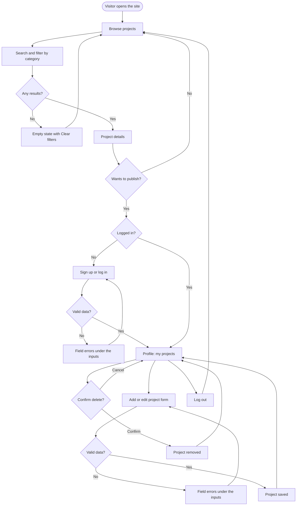

# Women in Tech · Student Showcase

A web platform where students of the Paper Airplanes *Women in Tech* program publish their projects, and visitors can browse them by category.

> **Status:** the front end is complete and runs on sample data. The PHP API and the MySQL database are in progress.

## Features (MVP)

- Browse projects with a title search and a category filter (Web, UI/UX, AI, Data)
- Project details page with links to the code and the live demo
- Sign up, log in and log out
- Students publish, edit and delete **their own** projects (delete asks for confirmation)
- Profile page listing the student's projects
- Responsive layout, keyboard-friendly controls, and reduced-motion support for the animated planes

## Tech stack

| Layer | Technology |
| --- | --- |
| Front end | React 19 (Vite), React Router |
| Back end (in progress) | PHP 8 with PDO, JSON API |
| Database (in progress) | MySQL |
| Fonts | Fraunces and DM Sans (via `@fontsource`) |

## Getting started

### Front end

Requirements: Node.js 20 or newer.

```bash
cd frontend
npm install
npm run dev
```

Open the address printed in the terminal (usually `http://localhost:5173`).

### Back end (coming soon)

1. Install XAMPP and start Apache and MySQL.
2. Import `database/schema.sql` with phpMyAdmin.
3. Copy the `api` folder to `htdocs/showcase/api`.

## Pages and routes

| Route | Access | Purpose |
| --- | --- | --- |
| `/` | Everyone | Home: hero, featured projects, about |
| `/projects` | Everyone | Browse with search and filter |
| `/projects/:id` | Everyone | Project details |
| `/login`, `/signup` | Visitors | Authentication |
| `/profile` | Logged in | My projects |
| `/share-project` | Logged in | Publish a project |
| `/edit-project/:id` | Owner | Edit or delete a project |

## User flow



## Data model (planned)

| Table | Columns |
| --- | --- |
| `users` | id, name, email (unique), password_hash, created_at |
| `categories` | id, name (unique) |
| `projects` | id, user_id, category_id, title, description, image_url, github_url, demo_url, created_at |

## API (planned)

| Method | Endpoint | Auth | Purpose |
| --- | --- | --- | --- |
| POST | `register.php` | No | Create an account |
| POST | `login.php` | No | Log in |
| POST | `logout.php` | Yes | Log out |
| GET | `projects.php?category=&q=` | No | List with filter and search |
| POST | `projects.php` | Yes | Publish a project |
| GET | `project.php?id=` | No | One project |
| PUT / DELETE | `project.php?id=` | Owner | Edit or delete |

Errors return `{"error": "message"}` with a suitable HTTP status code.

## Project structure

```
student-showcase/
  frontend/
    src/
      components/   Navbar, Footer, Layout, Hero, PlaneField, ProjectCard, ProjectForm, ...
      pages/        Home, Projects, ProjectDetails, Profile, ShareProject, EditProject, Login, SignUp
      data/         sample projects and categories
      assets/       project images
  api/              PHP endpoints (in progress)
  database/         schema.sql (in progress)
```

## Design notes

- Palette: navy `#0D1C42`, blue `#22396F`, cream `#FCF1D0`, ink `#010736`.
- The logo is an original mark (a folded W with a small paper airplane) made for this project. It is not the official Paper Airplanes logo.
- The animated planes use CSS only, and stop when the user prefers reduced motion.


## Known limitations

- Until the API is connected, projects are sample data and changes do not persist.
- Login is simulated in the browser, so it is not real security. Real authentication will be done with PHP sessions.
- Images are linked by URL. Uploading images is out of scope for the MVP.

## Roadmap

- [x] Front end with sample data
- [ ] MySQL schema and seed data
- [ ] Read endpoints and connecting the front end
- [ ] Create, update and delete endpoints
- [ ] Sessions, ownership checks and validation
- [ ] Testing, security checklist and final polish

## Credits

Built as the final project of the Web Development 2 course in the Paper Airplanes *Women in Tech* program. Project names, authors and descriptions in the sample data are fictional.
