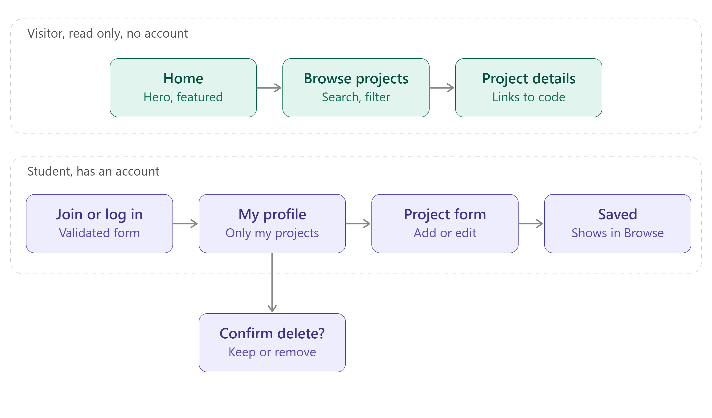

# Women in Tech · Student Showcase

A web platform where students of the Paper Airplanes _Women in Tech_ program publish their projects, and visitors can browse them by category.

> **Status:** The front-end is complete and runs on sample data. The PHP API and MySQL database are in progress.

## MVP Features

- **For Visitors:** Browse all projects, search, filter by category, and view project details without needing an account.
- **For Students:** Sign up, log in, and publish/edit/delete **their own** projects.
- Profile page to manage the student's projects.
- Responsive layout, keyboard-friendly controls, and reduced-motion support for the animated planes.

## Tech Stack

| Layer              | Technology                               |
| ------------------ | ---------------------------------------- |
| Front end          | React 19 (Vite), React Router            |
| Back end (planned) | PHP 8 with PDO, JSON API                 |
| Database (planned) | MySQL                                    |
| Fonts              | Fraunces and DM Sans (via `@fontsource`) |

## Getting Started

### Front end

Requirements: Node.js 20 or newer.

cd frontend
npm install
npm run dev

(Link: `http://localhost:5173`).

### Back end (coming soon)

1. Install XAMPP and start Apache and MySQL.
2. Import `database/schema.sql` with phpMyAdmin.
3. Copy the `api` folder to `htdocs/showcase/api`.

## Pages and routes

| Route | Access | Purpose |
| --- | --- | --- |
| `/` | Everyone | Home: hero, featured projects, about |
| `/projects` | Everyone | Browse with search and filter |
| `/projects/:id` | Everyone | Project details |
| `/login`, `/signup` | Guests | Authentication |
| `/profile` | Logged in | My projects |
| `/share-project` | Logged in | Publish a project |
| `/edit-project/:id` | Owner | Edit or delete a project |

## User flow



## Data model (planned)

| Table        | Columns                                                                                   |
| ------------ | ----------------------------------------------------------------------------------------- |
| `users`      | id, name, email (unique), password_hash, created_at                                       |
| `categories` | id, name (unique)                                                                         |
| `projects`   | id, user_id, category_id, title, description, image_url, github_url, demo_url, created_at |

## API (planned)

| Method       | Endpoint                    | Auth  | Purpose                     |
| ------------ | --------------------------- | ----- | --------------------------- |
| POST         | `register.php`              | No    | Create an account           |
| POST         | `login.php`                 | No    | Log in                      |
| POST         | `logout.php`                | Yes   | Log out                     |
| GET          | `projects.php?category=&q=` | No    | List with filter and search |
| POST         | `projects.php`              | Yes   | Publish a project           |
| GET          | `project.php?id=`           | No    | One project                 |
| PUT / DELETE | `project.php?id=`           | Owner | Edit or delete              |

Errors return `{"error": "message"}` with a suitable HTTP status code.

## Project structure
```

student-showcase/
frontend/
src/
components/ Navbar, Footer, Layout, Hero, PlaneField, ProjectCard, ProjectForm, ...
pages/ Home, Projects, ProjectDetails, Profile, ShareProject, EditProject, Login, SignUp
data/ sample projects and categories
assets/ project images
api/ PHP endpoints 
database/ schema.sql 
````

## Design notes

- Palette: navy `#0D1C42`, blue `#22396F`, cream `#FCF1D0`, ink `#010736`.
- The logo is an original mark (a folded W with a small paper airplane) made for this project.

## Known limitations

- Until the API is connected, projects are sample data and changes do not persist.
- No rate limiting on login attempts.
- Images are linked by URL. Uploading images is out of scope for the MVP.

## Roadmap

- [x] Front end with sample data
- [x] MySQL schema and seed data
- [x] Read endpoints and connecting the front end
- [x] Create, update and delete endpoints
- [x] Sessions, ownership checks and validation
- [x] Testing, security checklist and final polish

## Credits

Built as the final project of the Web Development 2 course in the Paper Airplanes _Women in Tech_ program. Project names, authors and descriptions in the sample data are fictional.
````
